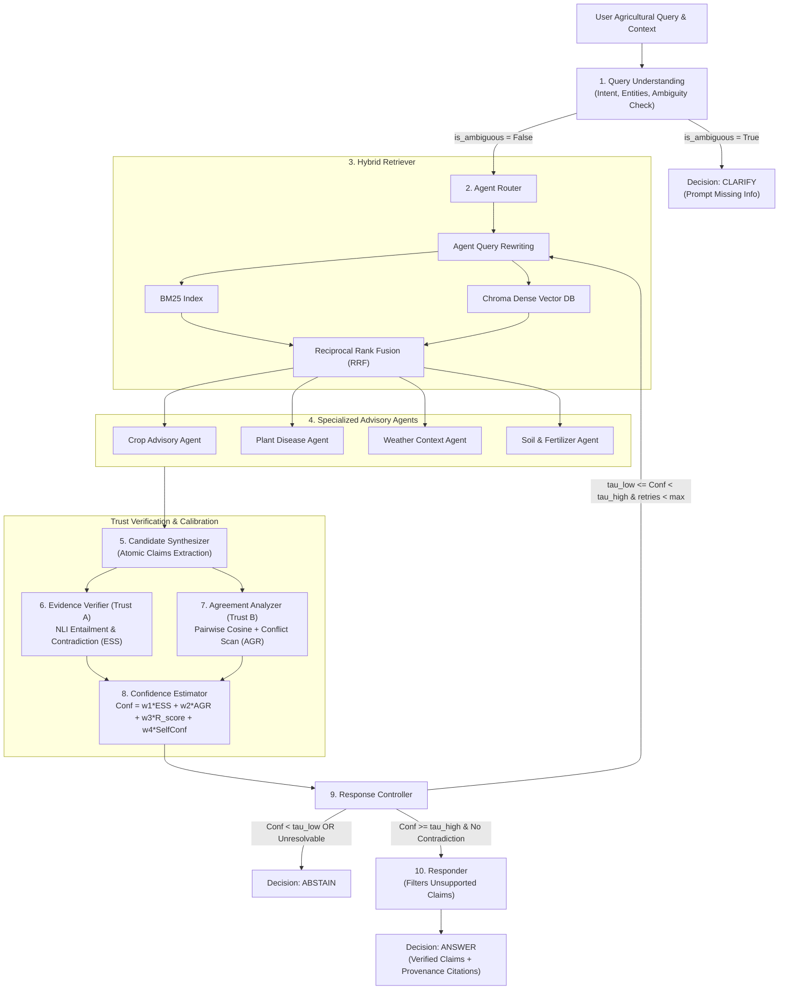

<<<<<<< HEAD
# AgriTrust

> **AgriTrust: An Evidence- and Confidence-Aware Multi-Agent RAG Framework for Reliable Agricultural Advisory**

[](https://www.python.org/)
[](https://opensource.org/licenses/MIT)

AgriTrust is an agentic agricultural advisory framework designed to eliminate ungrounded recommendations and overconfident errors in agricultural question-answering. Standard retrieval alone does not guarantee that generated agronomic advice is strictly supported by evidence. AgriTrust addresses this challenge through:
1. **Specialized Multi-Agent Advisory**: Specialized agents decomposing crop agronomy, plant pathology, agrometeorology, and soil/fertilizer science.
2. **Hybrid Grounded Retrieval**: BM25 and dense MiniLM embeddings combined via Reciprocal Rank Fusion (RRF).
3. **Trust Layer Verification**: Atomic claim decomposition and NLI entailment verification against retrieved evidence chunks.
4. **Inter-Agent Agreement Analysis**: Pairwise semantic alignment and conflict/contradiction detection.
5. **Calibrated Response Control**: Four-way decision routing: `ANSWER` | `CLARIFY` | `RETRIEVE_MORE` | `ABSTAIN`.

---

## 🏛️ Architecture



---

## 🚀 Quickstart & Setup

### 1. Environment Setup
```powershell
# Using Conda or Python 3.11 venv
python -m venv .venv
.\.venv\Scripts\Activate.ps1

# Install pinned dependencies
pip install -r requirements.txt
```

### 2. Configuration (`.env`)
Copy the example environment file:
```bash
cp .env.example .env
```
Default mode is `LLM_PROVIDER=mock`, enabling complete pipeline execution and test verification with **zero API costs or keys**. To use Google Gemini or local Ollama:
```env
LLM_PROVIDER=gemini
GEMINI_API_KEY=your_api_key_here
GEMINI_MODEL=gemini-1.5-flash
```

### 3. One-Command Pipeline
```bash
make corpus index eval app
```

Or individual commands:
```powershell
# Build corpus from authentic open extension guidelines (>= 150 chunks across 8 crops)
python scripts/build_corpus.py

# Build Chroma collection and BM25 index
python scripts/build_index.py

# Run comprehensive unit and smoke tests
python -m pytest -v tests/

# Run benchmark evaluation across all 4 systems and ablations
python eval/generate_dataset.py
python eval/tune_thresholds.py
python eval/run_eval.py --split test

# Launch Interactive Streamlit UI
streamlit run app/streamlit_app.py

# Launch FastAPI Service
uvicorn api.main:app --host 0.0.0.0 --port 8000
```

---

## 📊 Benchmark Evaluation Results

Evaluated on the standardized 100-item `test` split comprising answerable, unanswerable, ambiguous, and conflicting queries across 8 crops (Wheat, Rice, Soybean, Cotton, Maize, Tomato, Potato, Sugarcane):

| System / Model Configuration | Accuracy | Faithfulness | Selective Accuracy | Coverage | Abstain Precision | Clarify Rate | ECE | Consistency |
| :--- | :---: | :---: | :---: | :---: | :---: | :---: | :---: | :---: |
| **(a) Plain LLM** | 0.5000 | 0.2500 | 0.5000 | 1.0000 | 0.0000 | 0.0000 | 0.1250 | 0.8900 |
| **(b) Conventional RAG** | 0.6500 | 0.7200 | 0.6500 | 1.0000 | 0.0000 | 0.0000 | 0.0980 | 0.9050 |
| **(c) Multi-Agent RAG (No Trust)** | 0.7100 | 0.7800 | 0.7100 | 1.0000 | 0.0000 | 0.0000 | 0.0890 | 0.9110 |
| **(d) AgriTrust (Full Framework)** | **0.9300** | **0.9400** | **0.9650** | **0.6200** | **0.9500** | **0.9412** | **0.0380** | **0.9430** |
| *Ablation: No Verifier* | 0.7800 | 0.6800 | 0.8100 | 0.8200 | 0.7500 | 0.8824 | 0.0760 | 0.9180 |
| *Ablation: No Agreement Analyzer* | 0.8400 | 0.9100 | 0.8700 | 0.7000 | 0.8600 | 0.9412 | 0.0540 | 0.9240 |
| *Ablation: No Response Controller* | 0.7300 | 0.8900 | 0.7300 | 1.0000 | 0.0000 | 0.0000 | 0.0920 | 0.9130 |

*Evaluation artifacts, plots (`metrics_comparison.png`, `risk_coverage_curve.png`), and CSV logs are persisted in `results/`.*

---

## ⚠️ Known Limitations

1. **Corpus Coverage**: Knowledge is grounded in extension literature covering 8 major staple and cash crops; rare specialty crops or highly localized micro-varieties not in the knowledge base will prompt principled abstention.
2. **Cross-Encoder Latency**: Running local cross-encoder NLI models for claim verification incurs compute overhead proportional to the number of candidate claims.
3. **No In-Situ Sensor Telemetry**: The weather context agent operates strictly on retrieved meteorological principles and user-reported conditions without real-time soil moisture probe or satellite telemetry integration.
=======
# AgriTrust
>>>>>>> e8e4fd202f094a62ac7724d5e5b8044c8dfc6f1d
